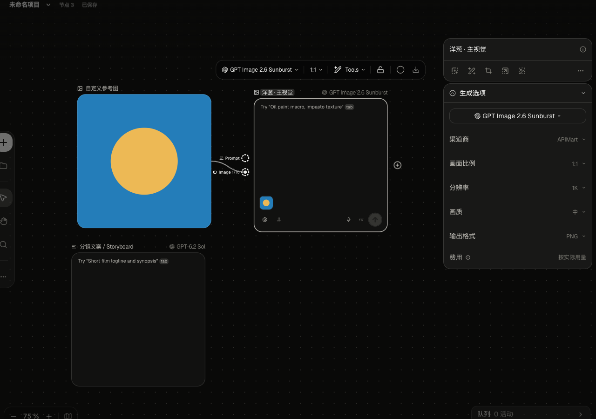
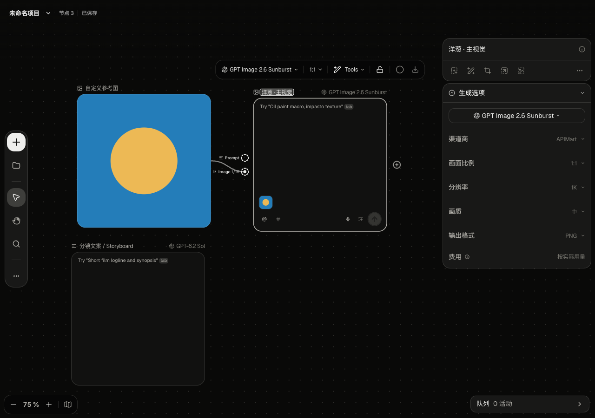

# 节点名称编辑验收

2026-11-22，本地 `http://127.0.0.1:5173/` 实际主画布，独立浏览器存储。参考 Flora 实际节点标题：悬停底色 `#fafaf223`、4px 圆角及左右 4px 留白；编辑时全选、随文字调整宽度。按用户后续要求，编辑框改用白色 `#fff` 内描边。

- 工具驱动的浏览器操作：选中后双击编辑、全选、Enter 保存、Escape 取消、Tab 失焦保存、撤销与重做、锁定、悬停、50% / 75% / 100% 缩放、减少动态效果、展开小地图、自动保存后刷新。刷新保留三个节点的名称、导入素材及参考连线。
- 主画布事件模拟：Image、导入图与 Text 的改名接入，未选中不能直接进入编辑、切换选择时保存、空白名称保留原名、输入法确认不提交、长名称不覆盖模型、改名不改变节点位置或视野；双轴标题拖动、参考图连线、替换图片保留自定义名称。素材为本地构造的 SVG，不调用真实模型。
- 自动检查：`npm run check`，318 项测试及 lint、类型、构建、文档链接和 diff 检查通过。没有额外的人手指针实测或生产验收。

